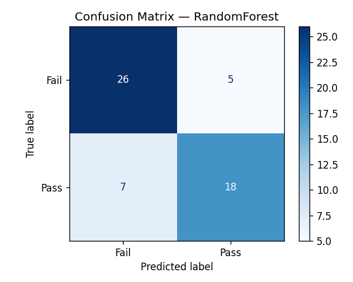
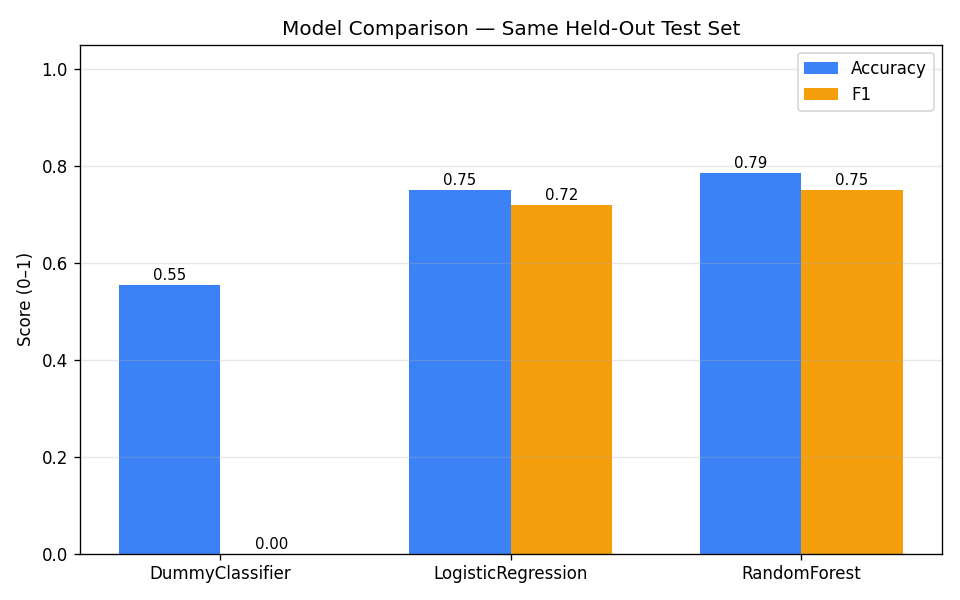
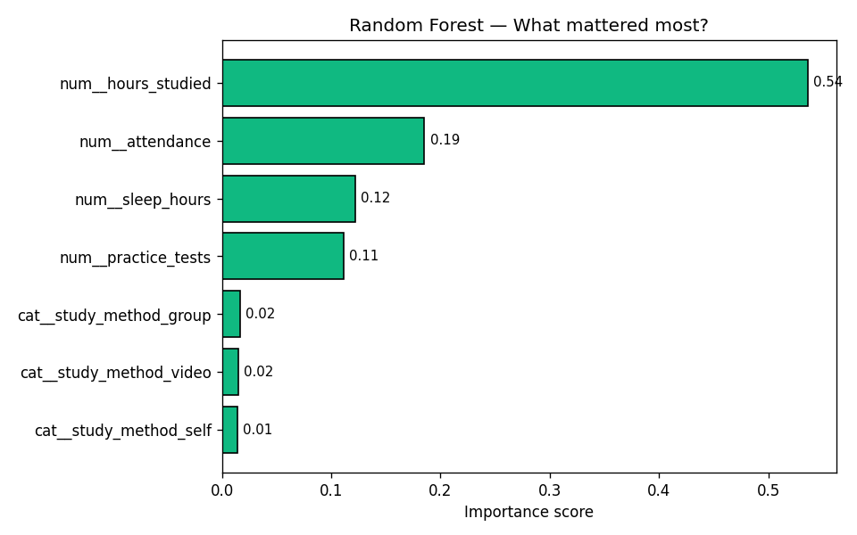

# Evaluation Summary (held-out test set, n=56)

All three models were evaluated on the **same** 20% held-out test set.

| Model | Accuracy | Precision | Recall | F1 |
|---|---|---|---|---|
| DummyClassifier | 0.554 | 0.0 | 0.0 | 0.0 |
| LogisticRegression | 0.75 | 0.72 | 0.72 | 0.72 |
| RandomForest | 0.786 | 0.783 | 0.72 | 0.75 |

**Selected model:** `RandomForest` — highest test F1, balanced precision/recall.

## Visual Evaluation

*Confusion matrix for the selected model, positive class = Pass.*

*Accuracy and F1 for all three models on the SAME held-out test set.*

*Feature importances (descriptive, not a proof of cause).*